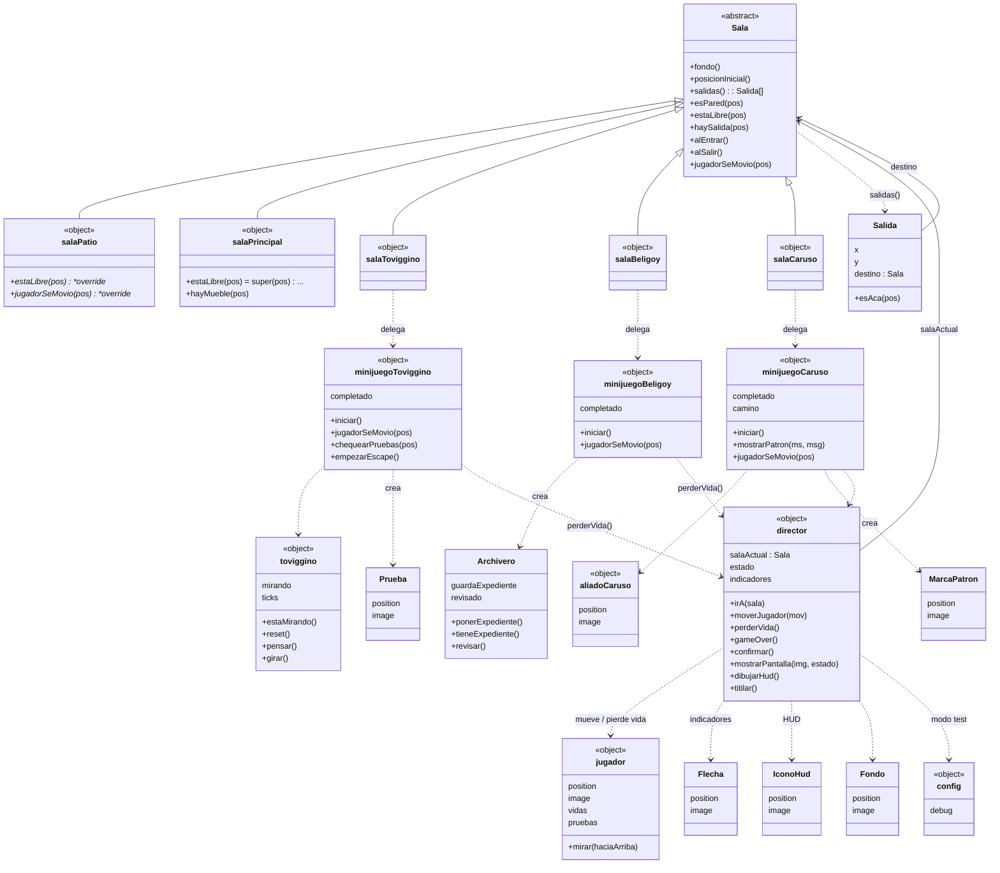

# Diagrama de clases — Chiqui Mafia Game

## Notas de diseño (para la defensa)

- **Clase abstracta + herencia:** `Sala` define el contrato (`fondo`, `posicionInicial`, `salidas`, movimiento, colisiones) y 5 salas lo heredan.
- **override:** cada sala redefine `fondo`, `posicionInicial`, `salidas`, y algunas `estaLibre` / `jugadorSeMovio`.
- **super:** `salaPrincipal.estaLibre(pos) = super(pos) and not hayMueble(pos)` — reutiliza la lógica base (bordes) y le suma las paredes de los muebles.
- **Delegación:** las salas de minijuego no tienen la lógica adentro; delegan en los objetos `minijuego*` (bajo acoplamiento, responsabilidades separadas).
- **Coordinador (`director`):** centraliza transiciones entre salas, vidas, game over y HUD.
