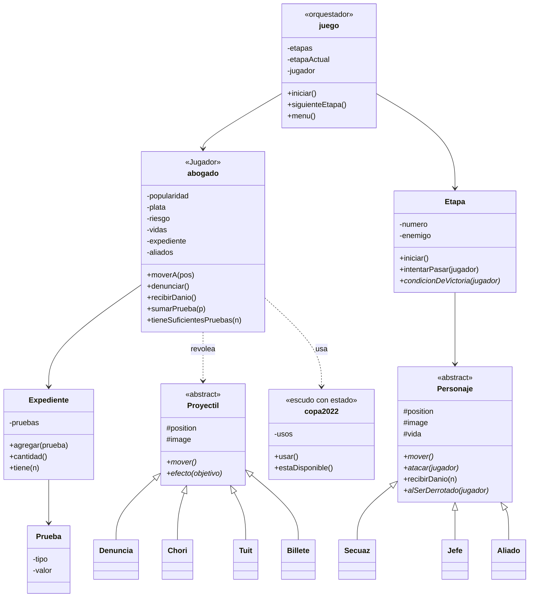

# Chiqui Mafia Game — Documento de Diseño

> **Materia:** Paradigmas de Programación (UTN) · **Herramienta:** Wollok + Wollok Game
> **Equipo:** LosDelFondo · **Repo:** `2026-tpGame-ChiquiMafiaGame-LosDelFondo`
> **Estado del documento:** v1 — base para empezar a codear. Las secciones marcadas con 🟡 **A DEFINIR** son decisiones abiertas que vamos puliendo en equipo.

---

## 0. Nota de parodia (leer primero)

Esto es una **comedia / sátira** inspirada en controversias **públicas** del fútbol argentino. Todos los personajes son **parodias** (apodos, exageraciones humorísticas) y **no** afirman hechos reales sobre personas concretas. El objetivo es cómico y, sobre todo, **pedagógico**: lo que se evalúa es el **código y el diseño en objetos**, no el juego como producto.

> Regla de oro de la cátedra: *"Un buen juego con mal código no aprueba."* Todo este documento está organizado alrededor de eso.

---

## 1. Pitch en una línea

Sos **un abogado novato que nadie conoce** y querés **atrapar al Chiqui**, el capo de la mafia del fútbol. Para llegar a él tenés que ir **juntando pruebas y ganando popularidad** derrotando a sus secuaces, etapa por etapa, hasta el duelo final en la AFA.

---

## 2. Qué se evalúa (rúbrica → nuestro diseño)

El enunciado dice que se evalúan **conceptos de la materia** y **del paradigma**. Mapeamos cada uno a dónde lo vamos a mostrar:

| Concepto evaluado | Dónde lo mostramos en el juego |
|---|---|
| **Polimorfismo** | `Proyectil.efecto()`, `Personaje.atacar()`, `Etapa.condicionDeVictoria()`, `Personaje.alSerDerrotado()` |
| **No repetición de lógica (DRY)** | Clase abstracta `Personaje` y `Proyectil` con comportamiento común; template methods |
| **Delegación** | El `Jugador` delega en `Expediente` el manejo de pruebas; `Etapa` delega en su `enemigo` |
| **Expresividad** | Nombres del dominio: `denunciar()`, `tieneSuficientesPruebas()`, `copa2022.estaDisponible()` |
| **Desacoplamiento** | `juego` orquesta sin conocer detalles internos de cada etapa/personaje |
| **Herencia / override / super / abstractas** (Entrega 2) | `Secuaz` / `Jefe` / `Aliado` heredan de `Personaje`; `Jefe` hace `override` de `recibirDanio()` usando `super` |
| **Testing** (todas las entregas) | Tests de dominio (sin UI): pruebas, condiciones de victoria, escudo que se gasta |
| **Diagrama de clases** (Entrega 2) | Sección 7 de este documento |

---

## 3. Mecánica central (gameplay loop)

Reutilizamos y generalizamos lo que **ya funciona** en la Entrega 1 (el shooter `detective` vs `chiqui` con `revolear()`):

1. El **Jugador** se mueve en la grilla (WASD) y **revolea denuncias** (proyectil que sube).
2. Los **enemigos** se mueven con su propio patrón y **atacan** con su propio proyectil (choris, tuits, billetes, silbatos…).
3. Las **colisiones** aplican efectos polimórficos (daño, sumar prueba, sumar/sacar stats).
4. El juego es una **progresión de Etapas**. Cada etapa es una confrontación con un personaje y tiene una **condición de victoria medible**.
5. Al ganar una etapa, el Jugador recibe una **recompensa** (prueba / plata / aliado) y pasa a la siguiente.
6. La última etapa es el **duelo final contra el Chiqui**, que solo se puede dañar si el Jugador juntó suficientes pruebas y popularidad.

> **Continuidad con la Entrega 1:** `detective` → se renombra a `abogado` (el Jugador). `Denuncia` y `Chori` → se generalizan a la clase abstracta `Proyectil`. `chiqui` → pasa a ser el `Jefe` de la última etapa. **Nada del trabajo hecho se tira**, se refactoriza.

---

## 4. Stats del Jugador

| Stat | Qué representa | Cómo sube | Cómo baja |
|---|---|---|---|
| **Popularidad** | Qué tan conocido/creíble sos | Ganar etapas, denunciar al Tuitero | Tuits en contra |
| **Pruebas** (`Expediente`) | Colección de evidencia | Derrotar secuaces, recolectar en el mapa | (no baja) |
| **Aliados** | NPCs que te ayudan | Ganar ciertas etapas (El Fideo, La Bruja) | — |
| **Plata** | Recursos | Aceptar coimas (¡sube el riesgo!) | Gastar en algo 🟡 A DEFINIR |
| **Riesgo** | Qué tan en la mira estás | Aceptar coimas, hacer ruido | 🟡 A DEFINIR (¿baja con el tiempo?) |
| **Vidas** | Vida clásica del shooter | — | Recibir proyectiles enemigos |

> 🟡 **A DEFINIR:** balance (valores iniciales, cuánta plata/riesgo da cada coima, cuántas pruebas pide el Chiqui). Lo cerramos cuando tengamos el loop andando.

---

## 5. Personajes

Clase base abstracta `Personaje`. Tres roles (subclases): **Secuaz**, **Jefe**, **Aliado**.

| Personaje (parodia) | Inspiración pública | Rol | Mecánica / proyectil | Recompensa al derrotarlo |
|---|---|---|---|---|
| **El Chiqui** | "Tapia" | **Jefe** final | Mucha vida + varios patrones de ataque | Fin del juego (victoria) |
| **El Árbitro / VAR** | el arbitraje | Secuaz | Tira **silbatos/tarjetas**, mueve errático | Prueba |
| **El Tesorero Tuitero** | "Toviggino" | Secuaz | Spamea **tuits** que bajan tu popularidad | Prueba + popularidad |
| **El Financista** | "Sur Finanzas" / lavado | Secuaz | Tira **billetes** (coima: plata ↑ pero riesgo ↑) | Prueba financiera |
| **El Fideo** | "Di María" | **Aliado** | Te ayuda a robar el acta / te abre paso | Se suma como aliado |
| **La Bruja** | "Verón / Estudiantes", el pasillo | **Aliado** (o secuaz 🟡) | El "pasillo de espaldas" como mecánica de distracción | Aliado |
| **El León** | "Milei" / las SAD | Comodín/evento 🟡 | Aparece peleando por las **SAD**; evento opcional | 🟡 A DEFINIR |

> 🟡 **A DEFINIR:** si **La Bruja** y **El León** entran como personajes jugables de una etapa o como contenido extra (Entrega 3 / final). Recomiendo dejarlos como **contenido extra** para no inflar el alcance.

**Dato extra para chistes (contexto paródico, úsese con pinzas y en tono humorístico):** el VAR, las **SAD** (Sociedades Anónimas Deportivas), los sponsors financieros, el "campeón de la tabla anual", el "pasillo". Son ganchos cómicos conocidos; en el juego aparecen como gags, no como acusaciones.

---

## 6. Etapas / Minijuegos (REDEFINIDOS)

Diseño unificado: **el juego es una sucesión de `Etapa`s**. Cada `Etapa` conoce a su `enemigo` y define su **`condicionDeVictoria(jugador)` polimórfica**. Esto reemplaza la idea de "dos modos sueltos" por **una sola arquitectura** que da mucho reuso de código (que es justo lo que se evalúa).

| # | Nombre | Personaje | Mecánica | **Condición de victoria (medible)** | OOP que luce |
|---|---|---|---|---|---|
| 1 | **El Becario** | Árbitro/VAR | Esquivar silbatos + recolectar pruebas por el mapa | `expediente.cantidad() >= 3` sin quedarte sin vidas | Proyectil polimórfico + colección |
| 2 | **Seguí la Plata** | El Financista | Dilema: tocar billetes da plata pero sube riesgo | Juntar N pruebas con `riesgo < umbral` | `efecto()` que toca stats distintos |
| 3 | **El Tuitero** | Tesorero Tuitero | Duelo de popularidad a proyectiles | `jugador.popularidad() > tuitero.popularidad()` al terminar el tiempo | Comparación de stats |
| 4 | **La Copa Regalada** | El Fideo (aliado) | Robar el **acta** (visual con estado) y escapar; el aliado te ayuda | Tocar el acta y volver al inicio | `Aliado` polimórfico + objeto con estado |
| 5 | **El Escudo Mundial** | — (la **Copa2022**) | Decisión difícil: usar la Copa2022 como escudo (se gasta) o guardarla | Sobrevivir el embate | **Objeto con estado que se gasta** |
| 6 | **La AFA** | **El Chiqui** (jefe) | Duelo final | `chiqui.vida() <= 0` — y solo le pegás si `expediente.cantidad() >= N` y `popularidad >= M` | Herencia + gate por colección |

> 🟡 **A DEFINIR:** si las 6 etapas entran todas o arrancamos con **1 + 3 + 6** (recolección, duelo de stats y jefe) para la Entrega 2 y sumamos el resto en la Entrega 3. **Recomendación fuerte:** priorizar POCAS etapas bien hechas. Se evalúa el código, no la cantidad de niveles.

---

## 7. Diseño en objetos

### 7.1 Diagrama de clases

*(GitHub renderiza este diagrama Mermaid automáticamente. Para la Entrega 2 lo pasamos también a yUML si los tutores lo piden, como sugiere el Anexo A del enunciado.)*

### 7.2 Responsabilidades (quién hace qué)

- **`juego`** (objeto orquestador): arranca el juego, muestra el menú, conoce la lista de `Etapa`s y pasa de una a la siguiente. **No** conoce los detalles internos de cada enemigo (desacoplamiento).
- **`abogado`** (el Jugador): se mueve, revolea denuncias, recibe daño, y **delega** en `Expediente` todo lo de las pruebas.
- **`Expediente`**: colección de `Prueba`. Responde `cantidad()`, `tiene(n)`, `agregar(p)`. (Delegación: el jugador no manosea la lista directamente.)
- **`Personaje`** (abstracta): lo común a todos los NPCs (posición, vida, `recibirDanio()`). Define como **abstractos** `mover()`, `atacar()` y `alSerDerrotado()`.
  - **`Secuaz`**: enemigos normales (Árbitro, Financista, Tuitero).
  - **`Jefe`**: el Chiqui. `override recibirDanio()` usando `super` (ej.: además de bajar vida, `game.say()` un chiste) y chequea el gate de pruebas.
  - **`Aliado`**: El Fideo / La Bruja. Su `atacar()` en realidad **ayuda** al jugador (polimorfismo que subvierte el método).
- **`Proyectil`** (abstracta): `mover()` (dirección) y `efecto(objetivo)` polimórfico. `Denuncia` sube y daña enemigos; `Chori`/`Tuit`/`Billete` bajan y hacen cosas distintas.
- **`Etapa`**: conoce su `enemigo` y define su `condicionDeVictoria(jugador)` polimórfica e `intentarPasar(jugador)`.
- **`copa2022`**: objeto-escudo **con estado que se gasta**. `usar()` protege una vez y pasa a estar gastada; `estaDisponible()` lo informa.

### 7.3 Dónde está el polimorfismo (explícito)

| Mensaje | Objetos que lo responden distinto |
|---|---|
| `efecto(objetivo)` | `Denuncia` (daña enemigo) vs `Billete` (plata↑ riesgo↑) vs `Tuit` (popularidad↓) |
| `atacar(jugador)` | cada `Secuaz` lanza su proyectil; el `Aliado` en vez de atacar, ayuda |
| `condicionDeVictoria(jugador)` | juntar N pruebas / más popularidad / matar al jefe / sobrevivir |
| `alSerDerrotado(jugador)` | da una `Prueba`, o plata, o suma un aliado |
| `mover()` | el Chiqui va y vuelve; el Árbitro es errático; etc. |

---

## 8. Mapeo a las entregas

Fechas del enunciado (cronograma oficial):

| Entrega | Código | Evaluación | Qué se espera |
|---|---|---|---|
| **0 — Ideas** | 25/09 | 25/09 | 2-3 ideas con dónde va el polimorfismo ✅ (ya pasó) |
| **1 — Lógica básica** | 05/10 | 09/10 | Polimorfismo + clases + testing ✅ (hecha: shooter con `revolear()`) |
| **2 — Más desarrollo** | 12/10 | 16/10 | **Herencia, override/abstractas/super + diagrama de clases + tests** |
| **3 — Versión final** | 19/11 | 23/11 | Juego terminado + más variedad + tests (ej.: 2 jugadores / menú) |
| **Final — Presentación** | 29/11 | 30/11 | Demo de 5 min + defensa del diseño |

### Checklist Entrega 2 (la próxima — foco acá) 🎯
- [ ] Refactor: `detective` → `abogado`; extraer clase abstracta `Proyectil` (de `Denuncia`/`Chori`).
- [ ] Clase abstracta `Personaje` con `Secuaz` / `Jefe` / `Aliado`.
- [ ] Al menos un `override` con `super` (en `Jefe.recibirDanio()`).
- [ ] `Expediente` + `Prueba` (colección) con delegación desde `abogado`.
- [ ] `Etapa` con `condicionDeVictoria()` polimórfica (mínimo 2 etapas distintas).
- [ ] Menú principal: al perder, volver al menú (no cerrar el juego).
- [ ] Diagrama de clases actualizado (sección 7.1).
- [ ] Tests de dominio nuevos (ver sección 9).

### Entrega 3
- [ ] Completar las etapas que falten, `copa2022`, aliados.
- [ ] Idea de variedad: modo **2 jugadores** o etapas extra (El León / La Bruja).
- [ ] Pulir balance y feedback visual/sonoro.

---

## 9. Testing (se evalúa en TODAS las entregas)

Tests de **dominio puro** (sin UI de Wollok Game), que es lo testeable y lo que valoran:

- `Expediente`: al `agregar()` una prueba, `cantidad()` sube; `tiene(3)` da `false` con 2 y `true` con 3.
- `abogado`: al `recibirDanio()` baja una vida; delega bien en `expediente`.
- `Proyectil`: `Denuncia.efecto(enemigo)` le baja la vida; `Billete.efecto(abogado)` sube plata y riesgo.
- `condicionDeVictoria()`: la Etapa 1 da victoria con 3 pruebas; la Etapa 3 con más popularidad.
- `Jefe`: no recibe daño si `abogado.tieneSuficientesPruebas(n)` es `false`.
- **`copa2022`**: `estaDisponible()` es `true`, se `usar()`, y queda `false` (se gastó).

---

## 10. Assets (imágenes y sonidos)

Ya tenemos: `chiqui.png`, `detective.png`, `chori.png`, `Denuncia.png`. Fuentes legales que recomienda el enunciado:
- OpenGameArt — https://opengameart.org/
- Kenney (Creative Commons) — https://www.kenney.nl/assets?q=2d
- Pixelorama (editor pixelart propio) — https://orama-interactive.itch.io/pixelorama
- FreeSound — https://freesound.org/

> 🟡 **A DEFINIR:** estilo visual (pixelart propio vs packs) y si usamos sonidos (silbato, "cash", notificación de tuit).

---

## 11. Decisiones abiertas (para pulir en equipo)

1. **Alcance de modos/etapas:** ¿las 6 etapas o arrancamos con 3 bien hechas? *(Recomiendo 3 y crecer.)*
2. **Stats:** balance y si `riesgo`/`plata` tienen un uso real o son decorativos. *(Deben tener efecto o los sacamos — expresividad.)*
3. **El León y La Bruja:** ¿contenido base o extra de Entrega 3?
4. **Nombre del jugador:** `abogado` (recomendado) vs mantener `detective`.
5. **"Dos modos" del pitch original:** propongo colapsarlos en una sola progresión de etapas. Si queremos un segundo modo, que sea **2 jugadores** (Entrega 3) reusando los mismos objetos.
6. **Menú:** ¿pantalla de menú con `game` o selección por teclado simple?

---

## 12. Glosario del dominio (para que el código hable en criollo)

- **denunciar / revolear**: el jugador lanza una `Denuncia`.
- **expediente**: la colección de pruebas juntadas.
- **secuaz**: enemigo al servicio del Chiqui.
- **gate de pruebas**: no podés dañar al Chiqui sin suficientes pruebas.
- **copa2022**: comodín-escudo de un solo uso.

---

*Documento vivo. Lo vamos actualizando entrega a entrega. Dudas/decisiones → sección 11.*
